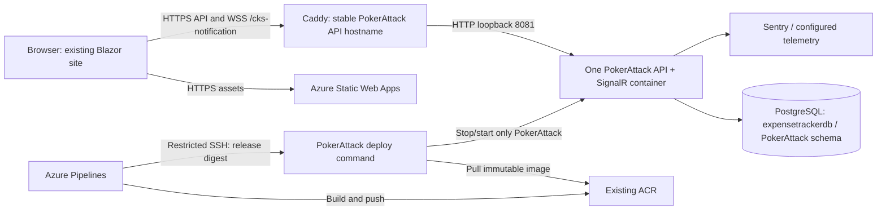

# PokerAttack API and SignalR migration to Linode

**Implementation decision update — 2026-11-14:** Owner selected `api.playpokerattack.com` (pilot `pilot-api.playpokerattack.com`) and GitHub Actions delivery similar to TransitJazz. These supersede the proposed hostname and Azure Pipelines delivery choice in this original design. Translate environment protection, branch control, immutable-image gates and deployment serialization to GitHub Actions during WP09. See the execution checklist and WP01/WP02 evidence for actual status.

**Prepared:** 2026-11-14
**Status:** Proposed design; planning only. No migration actions have been executed.
**Execution record:** [Agent checklist](LINODE_MIGRATION_STEP_BY_STEP.md)
**Implementation breakdown:** [Work packages](LINODE_IMPLEMENTATION_WORK_PACKAGES.md)

## 1. Recommendation and scope

Move the existing combined .NET API and SignalR process from Azure Container Apps (ACA) to **one always-running Linux container on Linode**, behind Caddy HTTPS. Keep Azure Static Web Apps, Azure Container Registry (ACR), the existing PostgreSQL database, and Sentry initially. Retain Azure DevOps for CI/CD. Use a separate pilot database and browser build, then a scheduled stop/start production cutover with a tested rollback.

**Owner-confirmed database topology:** production PostgreSQL already runs on the same existing Linode server. PokerAttack uses database `expensetrackerdb`, schema `PokerAttack`, alongside other application data. Retain that database and schema in place. This is owner-provided production information, not a live connection check performed during planning. The repository's `DbSchemas.PokerAttack` and entity mappings also use `PokerAttack`; access credentials, TLS, permissions and migration-history location still require verification.

**Owner-selected implementation assumptions:** use the existing shared Linode and assume it has sufficient capacity at this time. Allocate the combined API/SignalR container **0.25 CPU cores and 0.5 GiB (512 MiB) memory**, matching the supplied Azure allocation screenshot. Host selection, a capacity study, purchase and resize are not prerequisites. Continue ordinary port/service inventory and runtime observation; report observed failures without silently increasing limits or resizing the host. All DNS record changes are manual owner/operator actions; the agent prepares the exact records and performs read-only verification.

The migration includes hosting configuration, health checks, production test-route restrictions, a reliable client recovery path, container deployment, monitoring, backups, and pipeline changes necessary for the move. It does not include database relocation, a new authentication system, durable live-game state, horizontal scaling, Kubernetes, a registry migration, or changing CI providers. No implementation files are supplied by this planning pass.

**Availability constraint:** active lobbies, hands, timers, connection tracking, and game state are process-local. Stopping the process loses them. PostgreSQL history survives, but does not reconstruct a live match. Plan maintenance and require players to start fresh after a server restart; do not promise seamless reconnection or zero-downtime deployment.

Proposed operating targets, to confirm before execution: at most 15 minutes for a routine maintenance cutover or application rollback; pilot soak of at least 24 hours; production observation of 7–14 days before retiring ACA. Database disaster-recovery targets must be selected separately from measured backup/restore times.

## 2. Evidence and confidence

PokerAttack was inspected at local HEAD `b6a4d17d8eb42e9f9bee8214021406ff8be22659`. Existing unrelated untracked `.claude/skills/` content was left untouched. No applicable `AGENTS.md` was found in the checkout or checked ancestor locations. This review inspected source and deployment definitions; it did **not** query PokerAttack's live Azure/Linode configuration, change DNS, run deployments, or run application tests.

TransitJazz reference: [PR #77](https://github.com/henryfaulkner/ChefKnifeStudios.TransitJazz/pull/77), open at review time, head `6dfef670c72232af992416c09816cdbc0cdf86a8`. Prefer its [dated status report](https://github.com/henryfaulkner/ChefKnifeStudios.TransitJazz/blob/6dfef670c72232af992416c09816cdbc0cdf86a8/docs/LINODE_MIGRATION_STATUS.md) over stale assumptions in its original design. Its reported public pilot is working; production cutover, registry-based release deployment, some recovery checks, and ongoing backups remain unfinished. Those are reported TransitJazz results, not independently repeated PokerAttack results.

| Repository evidence | Current behavior | Design consequence |
| --- | --- | --- |
| [Program.cs](../src/Server/ChefKnifeStudios.PokerAttack.Server.WebAPI/Program.cs) | HTTP endpoints, `/cks-notification`, event subscriber, cleanup worker in one process | Move this process as one container |
| [API Dockerfile](../src/Server/ChefKnifeStudios.PokerAttack.Server.WebAPI/Dockerfile) | .NET 10 SDK/runtime; exposed port 8080 | Reuse build structure; set explicit Linode bind address |
| [Root Compose](../docker-compose.yml) | Builds API and EF bundle images | Keep it for builds; add a separate future production Compose definition |
| [Server pipeline](../deploy/server-pipeline.yml) | Azure DevOps builds both images, runs migrations, deploys `poker-attack-api` in `poker-attack-rg` | Preserve image publishing; replace deployment and separate schema changes |
| [Client pipeline](../deploy/client-pipeline.yml) | Publishes Blazor WASM to Azure Static Web Apps, sets `Blazor-Environment: prod`; triggers `main` and `deploy` | Retain hosting; verify effective published configuration and coordinate triggers |
| [Client settings](../src/Client/ChefKnifeStudios.PokerAttack.Client.WebApp/wwwroot/appsettings.json) | Both `PokerAttackAPI` and `PokerAttackSignalR` use generated ACA hostname | Publish both URLs together; custom DNS alone cannot move existing tabs |
| [Service defaults](../src/ChefKnifeStudios.PokerAttack.ServiceDefaults/Extensions.cs) | `/health` and `/alive` mapped only in Development; only self health check registered | Add production liveness and meaningful readiness before using proxy probes |
| [Test endpoints](../src/Server/ChefKnifeStudios.PokerAttack.Server.WebAPI/EndpointGroups/TestEndpoints.cs) | `/test/cleanup` clears all live repositories; `/test/signal-r` broadcasts; unconditionally mapped | Disable in production; isolate destructive tests |
| [Test helper](../tests/helpers/setup.ts), [test config](../tests/playwright.config.ts) | Global cleanup, cleanup URL derivation, TLS verification bypasses | Explicit isolated targets and real TLS verification are release gates |
| [Nightly pipeline](../deploy/e2e-nightly-pipeline.yml) | Uses production variable group; failures tolerated; schedule commented out but branch triggers active | Audit actual triggers; move destructive suite to isolated staging |
| [LobbyService](../src/Server/ChefKnifeStudios.PokerAttack.Server.BL/Services/LobbyService.cs), [GameService](../src/Server/ChefKnifeStudios.PokerAttack.Server.BL/Services/GameService.cs) | Create PostgreSQL game records and write/read rounds, alongside in-memory state | Database is required; pilot must not write test history to production |
| [SignalR service](../src/Client/ChefKnifeStudios.PokerAttack.Client.Core/Services/SignalRNotificationService.cs), [hub](../src/Server/ChefKnifeStudios.PokerAttack.Server.WebAPI/SignalR/SignalRNotificationHub.cs) | Automatic reconnect, no explicit group-rejoin callback; final disconnect removes player immediately | Test interrupted connections, multi-tab behavior, group delivery, and fresh-session recovery |
| [PlayerIdProvider](../src/Server/ChefKnifeStudios.PokerAttack.Server.WebAPI/SignalR/PlayerIdProvider.cs) | Player ID comes from query string | Preserve query strings; do not describe CORS or this ID as authentication |
| [BL test project](../src/Server/ChefKnifeStudios.PokerAttack.Server.BL.Tests/ChefKnifeStudios.PokerAttack.Server.BL.Tests.csproj) | `net9.0` tests reference projects now targeting `net10.0` | Resolve framework mismatch before counting test execution as a release gate |
| [Migration Dockerfile](../src/Server/ChefKnifeStudios.PokerAttack.Server.Data/Dockerfile) | .NET 10 build, EF tool 9.0.5, self-contained linux-x64 bundle, .NET 9 final base | Verify the actual bundle build/run independently; don't infer compatibility from tags |

The [older staging guide](staging-deployment-guide.md) says no database is needed and suggests a production client with a staging cleanup URL. Both are unsuitable here: gameplay writes PostgreSQL, and cleanup target selection does not change the browser's API or hub destination.

The development server configuration contains credential-bearing DB/storage settings and targets `expensetrackerdb_dev`. The owner confirms production uses `expensetrackerdb` with schema `PokerAttack`; the shared database name is intentional. Treat the checked-in credentials as exposed credentials to inventory and rotate through their owners during implementation. Do not copy them into this document, future image layers, or the Linode environment, or substitute the development database for production. No credential rotation occurred during planning.

## 3. What to carry forward from TransitJazz

The [execution guide](https://github.com/henryfaulkner/ChefKnifeStudios.TransitJazz/blob/6dfef670c72232af992416c09816cdbc0cdf86a8/docs/LINODE_MIGRATION_STEP_BY_STEP.md) and [deployment files](https://github.com/henryfaulkner/ChefKnifeStudios.TransitJazz/tree/6dfef670c72232af992416c09816cdbc0cdf86a8/deploy/linode) provide the pilot pattern.

| TransitJazz lesson | PokerAttack adaptation |
| --- | --- |
| Inventory first; back up and restore-test before touching the database VM | Inventory every co-tenant and protect their databases before Docker, firewall, resize, or reboot work |
| Linux host networking; API listens only on loopback | Candidate bind `127.0.0.1:8081`, after checking availability; TransitJazz already reports using 8080 |
| Caddy TLS and a stable API domain | Use a distinct hostname and a virtual host on the existing proxy if sharing; never start a second listener on 80/443 |
| Pilot capture/metrics disabled | PokerAttack has no equivalent production-write suppression flag: use a separate database/role and private pilot client |
| Retain one production statistics writer | Retain one authoritative production game process and retire stale client access to the old process |
| Public MessagePack city-stream verification | Use PokerAttack's existing JSON SignalR protocol, real multiplayer notifications, private player messages, and round persistence |
| Root-owned runtime env, immutable images, pull-only registry token | Separate PokerAttack paths, credentials, release lock, and images; never reuse TransitJazz secret files |
| Pull before stopping; serialize; rollback image/config | Add maintenance handling, external HTTPS and SignalR checks before promoting a known-good release |
| GitHub Actions deployment | Translate to existing Azure Pipelines; no GitHub workflow migration |
| Discover authoritative DNS | Query the chosen domain's actual authority; TransitJazz discovered Name.com despite having a nondelegated Azure zone |

The reported TransitJazz VM is Ubuntu 24.04 x86-64, 2 GB / 1 shared vCPU, already hosting PostgreSQL and Caddy. Those are reference observations, not new PokerAttack measurements. The owner's subsequent instruction establishes sufficient existing-host capacity as the planning assumption; no additional headroom threshold gates implementation.

## 4. Target architecture and networking



Proposed hostname: `pokerattack-api.henryfaulkner.xyz`, subject to domain control and collision checks. This name is a proposal, not an observed DNS record. Both client BaseUri values use `https://<chosen-host>/`; the client appends `/cks-notification` itself.

DNS is a manual handoff at checklist M01 (pilot) and M02 (production). The agent supplies the authoritative zone/provider, exact name/type/value/TTL, current record and reversal instructions. The owner/operator saves the records. The agent then verifies authoritative/public resolution and HTTPS before dependent work proceeds. This applies to additions, replacements, removals and DNS recovery; do not automate DNS through CLI, API, infrastructure code or browser tools.

Default Linux layout uses host networking, an explicit `ASPNETCORE_URLS=http://127.0.0.1:8081`, and no published Docker ports. Host networking shares the host namespace; Compose port publishing does not isolate it. Test the actual bind externally and locally. [Docker host networking](https://docs.docker.com/engine/network/drivers/host/).

| Placement | Proxy | Database route |
| --- | --- | --- |
| Existing shared Linode; capacity assumed sufficient | Extend existing Caddy configuration with a PokerAttack site; preserve its owner, certificate volumes and all existing sites | Verified host-loopback connection to `expensetrackerdb`, existing `PokerAttack` schema, app-scoped role |

Do not put PostgreSQL inside the application Compose project or move its volumes. With bridge networking, `localhost` means the container; any later switch to bridge networking requires an explicit database route and trusted-proxy redesign.

Open public TCP 80/443 at provider and host firewalls; scope SSH to the chosen operator/CI access model. Keep API port 8081 private, preserve necessary DB access for ACA rollback and existing consumers, and handle IPv6 as deliberately as IPv4. Publish AAAA only if the IPv6 listener, firewall and certificate path work. [Linode Cloud Firewall guidance](https://techdocs.akamai.com/cloud-computing/docs/cloud-firewall).

Caddy handles WebSocket upgrade and bidirectional proxying. Preserve hub path/query strings, negotiate POSTs and normal transport fallback; no path stripping or short stream timeout. Proxy reloads can close existing WebSockets, including other sites on a shared Caddy. Validate and schedule reloads, and test existing TransitJazz delivery afterward. [Caddy reverse proxy behavior](https://caddyserver.com/docs/caddyfile/directives/reverse_proxy).

## 5. Application hosting changes to implement later

| Area | Required behavior |
| --- | --- |
| Production environment | Explicit `ASPNETCORE_ENVIRONMENT=Production`; inspect any `DOTNET_ENVIRONMENT` override. Do not use ambiguous `prod` for server security gates |
| Forwarded headers | Trust only the actual loopback proxy address, one hop; process forwarded scheme/client IP before middleware consuming them; reject spoofed untrusted headers |
| CORS | Configured exact production origins, including verified apex/www and any actual SWA origin in use; credentials, methods and headers preserved; localhost/pilot origins separated |
| Host filtering | Allow chosen public hostname and intentional loopback probe host; reject unintended hosts without breaking local probes |
| Liveness | `/health/live`: process responsive; no external dependencies |
| Readiness | `/health/ready`: initialization complete plus bounded PostgreSQL connectivity/schema compatibility check; 503 on failure, generic payload with no secrets |
| Test routes | Map `/test/cleanup` and `/test/signal-r` only in explicit Development or isolated Staging, with explicit test enablement; never Production, including unrecognized environment values |
| Proxy restriction | Production virtual host denies `/test` and `/test/*`; app independently rejects test routes, including direct loopback requests |
| Shutdown | Start with host shutdown timeout 30s and container stop grace 60s; confirm writes finish within budget; this does not preserve live matches |
| Browser recovery | On disconnect/restart, show lost-session/reload-or-new-lobby behavior; reconnect transport alone must not leave a silently frozen game |

Use ASP.NET Core's explicit trusted-proxy configuration rather than accepting all forwarded headers. [Microsoft proxy guidance](https://learn.microsoft.com/en-us/aspnet/core/host-and-deploy/proxy-load-balancer?view=aspnetcore-10.0).

Retain one replica and default SignalR negotiation. A single process does not need session affinity infrastructure. Adding Redis or affinity alone would not distribute PokerAttack's game state or timers. [SignalR hosting guidance](https://learn.microsoft.com/en-us/aspnet/core/signalr/scale?view=aspnetcore-10.0).

SignalR group membership is not preserved on reconnect, and groups are in memory. If a session still exists, rejoin it only after verifying membership through the application's supported flow; if the server removed the player or restarted, return to a fresh-session flow. Do not recreate stale matches from client IDs. [SignalR group behavior](https://learn.microsoft.com/en-us/aspnet/core/signalr/groups?view=aspnetcore-10.0).

## 6. Container, configuration and data contract

Future files: `deploy/linode/compose.yaml`, `release.env.example`, proxy site example, `pokerattack-deploy`, `pokerattack-ssh-deploy`, deployment README, secret-file ignores and LF rules. None exists as a result of this planning pass.

Use Compose project `pokerattack-app`, application directory `/opt/pokerattack`, and root-only secrets directory `/etc/pokerattack`. Reserve a separate `pokerattack-pilot` project and alternate loopback port (proposed 8082) if staging and production overlap. Only one process may use production credentials at cutover.

`release.env` records immutable API image reference `chefknife.azurecr.io/chefknifestudios.pokerattack.server.webapi@sha256:<digest>`. The existing shared proxy image/configuration stays under its current deployment owner. Runtime secrets live in mode-0600 root-owned environment files. Keep known-good and previous-good image/config snapshots protected; they contain secrets. Application and migration images must be traceable to the same tested Git SHA when a migration is necessary.

The image should run as a non-root user on the unprivileged API port, without Docker socket or privileged mode. Verify runtime write paths before enabling a read-only root filesystem. Exclude credential-bearing development settings from published output and Docker build inputs; deleting them in a later layer does not remove earlier copies.

The specified application limits are **0.25 CPU and 512 MiB**, for API and SignalR together in one process. Future Compose must set service-level `cpus: 0.25` and `mem_limit: 512m`; use the same per-container limits for the isolated pilot. These are runtime ceilings, not reservations, and exclude the existing shared Caddy and PostgreSQL services. Verify Docker reports `NanoCpus=250000000` and `Memory=536870912` after deployment. Reuse the shared proxy's configuration and resource allocation. Observe application behavior under these limits during the pilot; do not impose a new host-capacity survey or minimum-memory-margin gate.

Use bounded container logs, e.g. five 10 MiB files, `restart: unless-stopped`, and an explicit shutdown grace period. A health check does not make Docker restart a still-running unhealthy app; handle readiness failure in deployment/monitoring and test startup when PostgreSQL becomes available late. Compose `env_file.format: raw`, if used to preserve secret characters, requires a supporting version (2.30+). [Compose service options](https://docs.docker.com/reference/compose-file/services/).

| Runtime setting | Delivery / requirement |
| --- | --- |
| `ConnectionStrings__PokerAttackDB` | Database `expensetrackerdb` on the existing Linode, verified app-scoped role and transport; entity mappings retain schema `PokerAttack`; never the checked-in development value |
| `ASPNETCORE_ENVIRONMENT`, `ASPNETCORE_URLS` | Explicit Production and loopback binding; pilot Staging only with isolated data |
| Proposed `Cors__AllowedOrigins__N`, `AllowedHosts` | Environment-specific allowlists; exact names finalized with implementation |
| `GameSettings__*`, `FeatureFlags__*` | Preserve effective production values; record a non-secret comparison |
| `Sentry__Dsn` and relevant Sentry settings | Preserve intended reporting with pilot/production distinction; review PII/query-string logging |
| `OTEL_EXPORTER_OTLP_ENDPOINT` and credentials, if used | Set only when there is a real reachable collector; existing ACA logging does not move automatically |
| Storage or other legacy settings | Retain only if verified runtime usage requires them; source review found no active Azure Storage use in C# |

Maintain a restricted runtime DB role and separate schema-migration credential. Verify TLS and certificate identity for remote connections. Do not weaken certificate validation to make a loopback hostname work; choose a valid local mapping/certificate or document a loopback-only transport decision.

Scope runtime permissions to required objects in `PokerAttack`, including necessary sequence access; verify that the role cannot modify unrelated application schemas. Preserve the existing schema spelling and mappings. Inspect the actual EF migration-history table and its ownership before executing a bundle: entity tables being in `PokerAttack` does not prove that migration history is there. The inspected registration does not explicitly configure a history-table schema. Do not relocate or clear shared migration history, change database-wide defaults, or grant broad privileges as part of this host move.

**Database changes:** no schema change is intrinsically required for relocation. Record EF history and compare the target release. If migrations are pending, review SQL and rehearse against a restored isolated DB; require backward compatibility with the rollback application or separate the schema release from this migration. Never automatically downgrade the DB during application rollback.

Back up databases, roles/globals, PostgreSQL configuration, proxy configuration/certificate storage, and protected runtime configuration. Encrypt off-host copies and prove restore on an isolated instance, including required extensions. A readable archive listing is insufficient. On a shared VM, protect all databases potentially affected by host work. Establish recurring backups and retention; a migration snapshot is not ongoing protection.

For `expensetrackerdb`, retain a consistent whole-database backup and restore-test both `PokerAttack` and unrelated application schemas. A schema-only export may supplement this but does not replace shared-database recovery. An application rollback must never overwrite the shared database or roll back other applications' data. Keep the pilot in a separate disposable database with the same `PokerAttack` schema mappings and isolated credentials.

## 7. Pilot and release methodology

1. **Baseline:** inventory live settings, deployed digest, ACA revision/traffic, DB identity, domain authority, resource peaks and rollback credentials. Resolve worksheet values.
2. **Prepare:** implement hosting/test isolation/recovery changes on a branch; resolve test framework/build issues; build and test in isolation. Preserve Azure build publishing while suppressing unintended deployment and destructive production tests.
3. **Pilot:** deploy immutable image on Linode against a disposable DB/role. Publish a separate pilot client pointing both URLs at it. Verify HTTPS, real multiplayer, DB writes, reconnect, resources, restart and rollback. Production browser configuration stays on ACA until the cutover step.
4. **Cut over:** enter maintenance, stop new sessions, finish or explicitly end active games, stop all ACA production replicas, switch Linode to verified production settings, and publish both client URLs. Record the UTC boundary.
5. **Observe and automate:** prove production behavior, recovery and repeatable restricted deployment. Retire ACA only after the observation window and all gates pass.

No synthetic production-wide cleanup is part of this plan. A harmless GET or a controlled game with disposable player IDs can verify production behavior; the cleanup endpoint remains absent. Full E2E tests use the pilot/staging client and DB.

**Cutover strategy:** use a brief maintenance interruption, not weighted traffic between two independent game processes. Before stopping ACA, deploy a simple maintenance landing page through the existing client hosting route if no maintenance mechanism exists, wait for verified active games to finish, and then deactivate every active ACA revision. This final stop also blocks stale tabs from starting more sessions. If active-game counts are unavailable, add an operator-only local observation mechanism or explicitly record the maintenance decision to terminate sessions; an empty lobby list is not proof that no games exist.

Existing tabs retain the ACA URL. Require reload, verify the freshly served appsettings and actual browser requests, and handle any service-worker/CDN cache discovered in inventory. Do not leave ACA serving old gameplay as a compatibility measure. A custom hostname CNAME to ACA requires ACA custom-domain/TLS binding; it is not an automatic rollback solution.

## 8. CI/CD and repeatable deployment

Retain `deploy/server-pipeline.yml` and ACR service connection. Proposed flow:

```text
test -> build/push -> resolve digest -> isolated staging + blocking E2E
     -> maintenance release window -> restricted SSH deployment
     -> local readiness + public HTTPS + real SignalR smoke -> promote known-good
```

Before the first production move, keep deployment stages explicitly disabled while builds remain usable. Audit `deploy/manual-build-and-deploy-server.ps1`, pipeline UI triggers, branch triggers, and queued runs so none can silently reactivate ACA. Client publication must remain coordinated and available for cutover/rollback.

Use Azure Pipelines environment `PokerAttack-Linode-Prod`, a dedicated variable group/secure SSH key, pinned host fingerprint, branch restrictions, and an exclusive deployment lock with sequential behavior. Environment checks are configured in Azure DevOps, not only YAML. [Azure Pipelines checks](https://learn.microsoft.com/en-us/azure/devops/pipelines/process/approvals?view=azure-devops). The host-side `flock` remains necessary to serialize manual and CI releases together.

Use a dedicated `pa-deploy` account without Docker-group membership; forced SSH command accepts only `deploy sha256:<64 hex>`; narrowly scoped sudo executes a root-owned, non-writable script. VM registry credentials grant pull only for required PokerAttack repositories. Confirm a viable runner network route before restricting SSH; do not install a general-purpose build runner on the shared DB VM.

The deployment command must pull/validate before stopping, verify a maintenance/drain condition, save image and configuration as a pair, stop only the PokerAttack server, start the candidate, and wait for bounded readiness. Recheck the running image digest and public HTTP/SignalR behavior before promoting known-good. A failed pull must leave the running server intact; failed startup must restore the previous pair and return failure even when recovery succeeds. Do not automatically run migrations, reload shared Caddy, or prune images/volumes during application deployment.

Rehearse malformed command rejection, lock contention, failed pull, failed readiness, public/hub failure despite local health, failed rollback, and interrupted SSH/host execution. A lost job is an unknown deployment until the host is inspected; never launch a competing release merely because CI timed out.

## 9. Acceptance criteria and operations

The checklist supplies per-step evidence. The following are proposed release gates, to adjust only with a recorded reason before testing:

| Gate | Evidence required |
| --- | --- |
| Hosting | Correct digest; exactly one production API process; public HTTPS valid with normal certificate verification; loopback API inaccessible externally |
| HTTP/CORS | Settings/scoring/lobby reads work; exact allowed-origin credentials grant; denied origin has no grant; production test routes absent in-process and through proxy |
| SignalR | Real negotiated WebSocket connection, expected notification method, private messages only to intended players, lobby/game groups and multi-tab behavior verified |
| Gameplay | At least one full multiplayer game with round persistence, power/shop actions, plus solo game; pilot DB only for automated tests |
| Recovery | Network interruption and container restart produce an understandable fresh-session path; no false claim that old matches resumed |
| Runtime stability | 24-hour pilot soak at 0.25 CPU / 512 MiB; no OOM/restart loop or observed co-tenant regression; existing host capacity assumed sufficient |
| Performance | Record baseline first; proposed 20 concurrent clients, at least two multiplayer games, API p95 <500ms and notifications <1s; use larger actual production peak if known |
| Recovery time | Candidate ready within 5 minutes in rehearsal; application rollback within 15 minutes; DB restore time measured separately |
| Operations | External uptime/readiness alert, certificate expiry monitoring, Sentry/telemetry, log rotation, disk/CPU/memory checks and recurring off-host backup with restore proof |
| Shared host | PostgreSQL and TransitJazz healthy before/after proxy work, deployment, load and planned reboot; no unrelated containers stopped |

Monitor the new hostname externally, readiness, reconnect/error rate, notification delays, game/round persistence errors, host/container resource use, disk growth, backup age and certificate expiry. Send a deliberate test signal to prove monitoring delivery. Record operator, escalation path, log access and rotation procedure. A local readiness probe cannot detect a dead VM from outside.

## 10. Rollback and retirement

**Release rollback on Linode:** hold the same deployment lock, enter maintenance, stop only PokerAttack, restore previous immutable image plus matching runtime config, start and verify health/public SignalR. Live matches restart from scratch. Preserve failure evidence and return a failed release result.

**Migration rollback to ACA:** stop Linode production first; reactivate the recorded ACA revision and restore its verified traffic weights, secrets and DB connectivity. Restore/publish the saved client artifact with both ACA BaseUri values. Verify fresh browsers use ACA, multiplayer and persisted rounds work, then end maintenance. Keep the stable Linode hostname visibly unavailable during rollback so cached clients reload instead of reaching a second game process. Do not assume revision activation alone repairs all traffic routing.

**Database/VM failure:** if the DB shares the failed Linode, moving the API to ACA does not recover the DB. Recover PostgreSQL through the tested off-host procedure, then start exactly one game server. Application rollback never restores an old DB snapshot by default, because that would discard newer committed results.

Immediate rollback triggers: invalid TLS, persistent readiness failure, missing group/private notifications, failed DB writes, restart/OOM loop, unresolved shared-host regression, or inability to complete a fresh game. Pause and diagnose minor issues only within the selected maintenance budget. Preserve compatible ACA image/config/DB access during 7–14 days of observation. Remove only inventoried obsolete ACA resources afterward; retain shared ACR, client hosting, database and shared observability.

## 11. Decisions to record before implementation

The checklist worksheet is the source of truth for these values; unresolved choices block only their dependent steps.

| Decision | Recommended starting position | Required evidence |
| --- | --- | --- |
| Linode placement | Existing shared Linode, capacity assumed sufficient by owner | Verify service ownership, ports and connection route; no capacity-selection gate |
| Hostname and DNS authority | `pokerattack-api.henryfaulkner.xyz` proposal; all DNS edits manual | Ownership, exact record handoff, operator completion and read-only resolution checks |
| DB and credentials | Owner-confirmed `expensetrackerdb` / `PokerAttack` on existing Linode; separate pilot DB and role | Verify effective connection, role permissions and migration-history ownership |
| Maintenance tolerance | Scheduled stop/start; live games may end | Selected window, drain/reset method, recovery expectation |
| Container allocation | Owner-selected 0.25 CPU / 0.5 GiB (512 MiB), one process | Compose limits and Docker runtime values match; pilot behavior recorded |
| Backups | Encrypted off-host, recurring; proposed daily, 14 daily + 4 weekly | Owner-selected durable-data RPO/RTO and actual restore result |
| Release execution | Azure Pipelines builds; manual restricted deploy until proven | Runner reachability and release/rollback rehearsals |
| Cost | Reuse existing host; no purchase or resize in scope | Record actual transfer/backup/monitoring and removable ACA costs during observation |

Do not copy TransitJazz prices or reported egress savings as PokerAttack estimates. Compare removable ACA compute/egress with incremental Linode compute/transfer, backups and monitoring, plus temporary overlap. ACR and Static Web Apps remain. Recheck current regional pricing during execution; this planning pass makes no purchase or verified savings claim.
